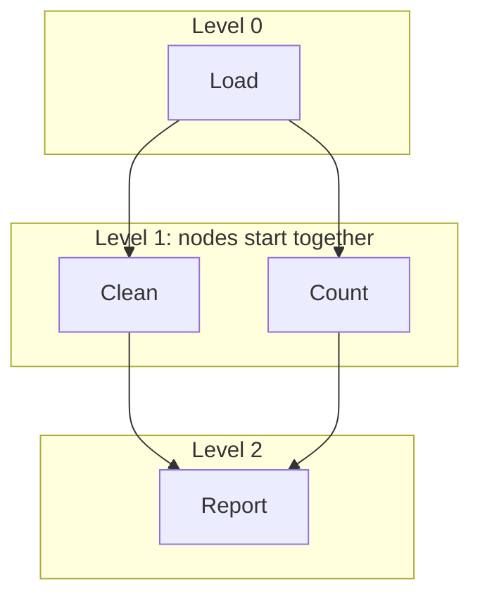

# Async and parallel execution

Use `AsyncStep` when a step awaits I/O, and `parallel=True` when independent steps block.

- `AsyncStep`: implement `async def arun(...)` and run the graph with
  `await pipeline.aexecute()`. Sync steps run unchanged inside `aexecute()`.
- `FanOutStep` under `aexecute()`: runs in a worker thread, with its branches in-process.
  `aexecute()` has no `dispatcher=`. A dispatcher passed there is ignored without an error.
- `StepResult.aresolve(context)`: resolve one node yourself. Use it when you schedule the graph
  (for example one `asyncio.gather` per level of `StepResult` nodes you sorted). Pass one
  `ResolveContext` to every call: it memoizes each node, so nothing runs twice. Gathered calls
  that reach the same node at the same time run its body once: the others wait for it.
- `aresolve_all(targets, context, max_concurrency=N)`: resolve several nodes inside your own
  event loop, one level at a time, with one shared memo. Nodes with the same cache key run once,
  a node with a saved result does not run its upstream nodes, and the first failure cancels the
  rest of its level and is raised as it is. `aexecute()` uses it with `max_concurrency=1`.
- `execute(parallel=True, max_workers=N)`: run independent steps on a thread pool.
- `timeout_s` (class attribute): a step that runs longer raises `StepTimeout`.



`aresolve_all` and `parallel=True` both work level by level. A level holds the nodes whose
upstream nodes are all done. The next level starts when the current one ends.

```python
--8<-- "docs/examples/async_parallel.py"
```

```text
aexecute: n=3
parallel: n=3, both Slow steps at once: True
```

`aresolve_all` inside a caller-owned loop:

```python
--8<-- "docs/examples/aresolve_all.py"
```

```text
[5, 6, 5]
```
