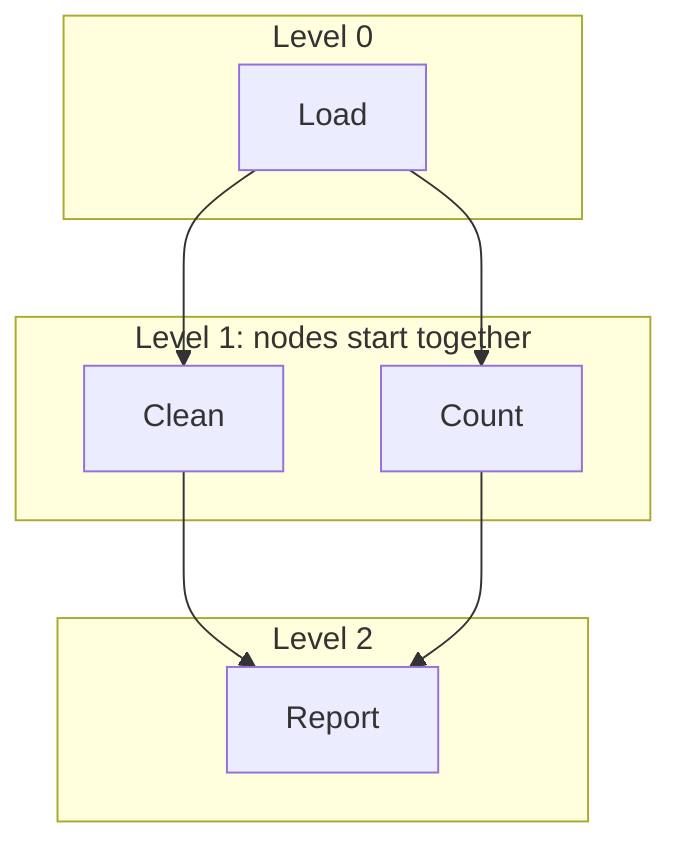

# Async and parallel execution

Use `AsyncStep` when a step awaits I/O. Use `parallel=True` when independent sync steps block.
Use `aresolve_all` when you already run an event loop and want steps to run at the same time.

## Async steps

- Subclass `AsyncStep` and implement `async def arun(...)`.
- Run the graph with `await pipeline.aexecute(**params)`.
- `aexecute()` runs one step body at a time. For concurrency, use `aresolve_all` below.
- Sync steps work under `aexecute()`. They run on the event loop and block it while they run.
- A `FanOutStep` runs in a worker thread, with its branches in-process. `aexecute()` has no
  `dispatcher=` argument: a dispatcher passed there is ignored without an error.
- `timeout_s` (class attribute): under `aexecute()` or `aresolve`, an async body that runs longer
  raises `StepTimeout`. `execute()` ignores it, and it cannot stop a blocking sync body.

## Threads for blocking steps

`execute(parallel=True, max_workers=N)` runs the independent steps of each level on a thread
pool.

```python
--8<-- "docs/examples/async_parallel.py"
```

```text
aexecute: n=3
parallel: n=3, both Slow steps at once: True
```

A level holds the nodes whose upstream nodes are all done. `parallel=True` and `aresolve_all`
both run one level at a time. The next level starts when the current one ends.



## Resolve nodes in your own event loop

Call `aresolve_all(targets, context, max_concurrency=N)` inside a request handler or a script
that already runs a loop. It returns the results in the order of `targets`.

1. Build one `ResolveContext` per run: `ResolveContext(params=..., cache_dir=..., observer=...)`.
2. Pass every node you want. adag sorts the graph into levels and runs one level at a time.
3. Read the results from the returned list.

```python
--8<-- "docs/examples/aresolve_all.py"
```

```text
[5, 6, 5]
```

The two `a.org` nodes have the same cache key, so `Fetch` runs once for both.

- Same key in one level: the step body runs once.
- Saved result: the node is loaded, and its upstream nodes do not run.
- `max_concurrency`: the most step bodies running at once. `None` runs a whole level together.
- Failure: the first exception cancels the rest of its level. It is raised as it is, not inside
  an `ExceptionGroup`.
- `FanOutStep` branches run inside the step. `max_concurrency` does not bound them.
- Params: `aresolve_all` does not check them. A missing required `InputParam` raises
  `ValueError` when its node resolves.

To schedule nodes yourself, `await node.aresolve(context)` resolves one node and its upstream
nodes. Pass the same context to every call: a node reached by two calls runs once.
