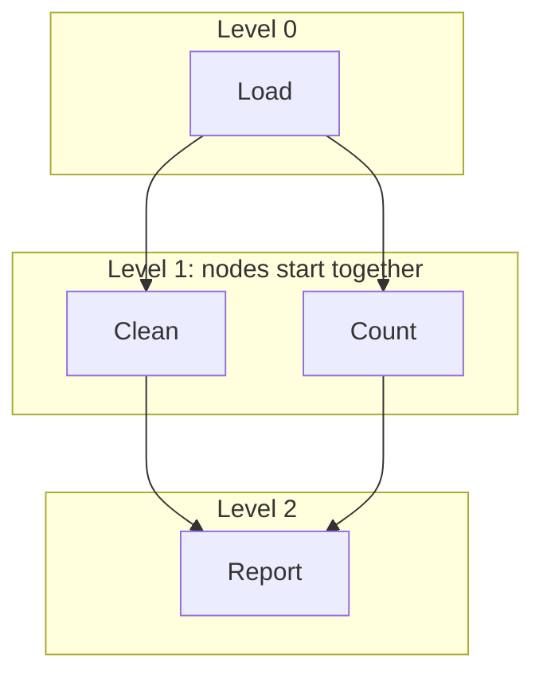

# Async and parallel execution

Set `runs_on` on a step to say where its body runs. Use `AsyncStep` when a body awaits I/O.
Use `aresolve_all` or `aexecute(max_concurrency=N)` to run several steps at once.

## Where a step runs

`runs_on` is a class attribute of the step. The default is `"loop"`.

| `runs_on` | The body runs | Use it for |
|---|---|---|
| `"loop"` | On the event loop. An `AsyncStep` awaits there. A sync body blocks the loop. | `AsyncStep`, and short sync steps |
| `"thread"` | In a worker thread. The loop stays free. | Blocking calls: a subprocess, a sync HTTP client, a C extension that frees the GIL |
| `"process"` | In a worker process. | CPU-bound Python code |

A thread shares the GIL, so it does not speed up CPU-bound Python code. Use `"process"` for that.

### Threads

```python
--8<-- "docs/examples/async_parallel.py"
```

```text
aexecute: n=3
threads: n=3, both Slow steps at once: True
```

### Processes

The example counts primes in four spans of numbers, once with `runs_on = "thread"` and once with
`runs_on = "process"`.

```python
--8<-- "docs/examples/runs_on.py"
```

```text
runs_on='thread'   8254 primes in 10.01 s
runs_on='process'  8254 primes in 6.25 s
```

The times are the median of three runs of adag 0.3.14 on a laptop (Intel i9-9880H, 8 cores) that
was also running other jobs, measured with `time.perf_counter()`. They include the start of the
worker processes. Your times will differ.

Rules for `runs_on = "process"`:

1. The step must pickle: define its class at the top level of a module. A class defined inside a
   function raises a `TypeError` that names the step.
2. A worker starts with `spawn` and imports your module. Guard a script with
   `if __name__ == "__main__":`, as in the example.
3. Only `run()` goes to the worker. A step that overrides `execute()` raises a `TypeError`.
4. The worker has no observer and no cache: `emit()` inside the body sends nothing. Observers
   see the step start and finish in the main process.
5. A step with no `run()`, such as an `AsyncStep`, cannot use `"thread"` or `"process"`.
6. Each worker imports your module when it starts, so a process pays off for bodies that run
   longer than that.
7. `Pipeline.execute()` and `Pipeline.aexecute()` end the workers when the run ends. If you
   build a `ResolveContext` yourself, call `context.close()` at the end.

`execute()` honours only `"process"`. A step with `"thread"` runs in the calling thread there.

## One limit for steps and branches

`Pipeline.aexecute(max_concurrency=1)` and `aresolve_all(..., max_concurrency=N)` bound how
many step bodies run at once. The count includes the steps inside the branches of a `FanOutStep`.
A `FanOutStep` itself holds no slot: it waits for its branches.

- The default of `aexecute` is 1, so one database session is never used by two steps at once.
- `None` runs a whole level together.
- A branch can hold an `AsyncStep`.
- A branch that raises cancels the other branches and raises as it is.

## Async steps

- Subclass `AsyncStep` and implement `async def arun(...)`.
- Run the graph with `await pipeline.aexecute(**params)`.
- Sync steps work under `aexecute()`. They run on the event loop and block it, unless the step
  sets `runs_on`.
- `aexecute()` has no `dispatcher=` argument: a fan-out under it runs its branches in this
  process. A dispatcher is ignored without an error.
- `timeout_s` (class attribute): under `aexecute()` or `aresolve`, an async body that runs longer
  raises `StepTimeout`. `execute()` ignores it, and it cannot stop a blocking sync body.

A level holds the nodes whose upstream nodes are all done. `aresolve_all` runs one level at a
time. The next level starts when the current one ends.



## Resolve nodes in your own event loop

Call `aresolve_all(targets, context, max_concurrency=N)` inside a request handler or a script
that already runs a loop. It returns the results in the order of `targets`.

1. Build one `ResolveContext` per run: `ResolveContext(params=..., cache_dir=..., observer=...)`.
2. Pass every node you want. adag sorts the graph into levels and runs one level at a time.
3. Read the results from the returned list.

```python
--8<-- "docs/examples/aresolve_all.py"
```

```text
[5, 6, 5]
```

The two `a.org` nodes have the same cache key, so `Fetch` runs once for both.

- Cache IO: a store with `runs_on = "thread"` (Redis, a SQL server) is called off the loop.
  Files under `cache_dir` are read and written on the loop. See
  [Cache stores](cache-stores.md#keep-a-network-store-off-the-event-loop).
- Equal nodes (one step class, one cache key): the step body runs once. See
  [Caching](caching.md#equal-nodes-run-once).
- Saved result: the node is loaded, and its upstream nodes do not run.
- `max_concurrency`: the most step bodies running at once, in any branch. `None` runs a whole
  level together.
- Failure: the first exception cancels the rest of its level. It is raised as it is, not inside
  an `ExceptionGroup`.
- `FanOutStep` branches are tasks of the same run, so `max_concurrency` bounds them too.
- Params: `aresolve_all` does not check them. A missing required `InputParam` raises
  `ValueError` when its node resolves.

To schedule nodes yourself, `await node.aresolve(context)` resolves one node and its upstream
nodes. Pass the same context to every call: a node reached by two calls runs once.
