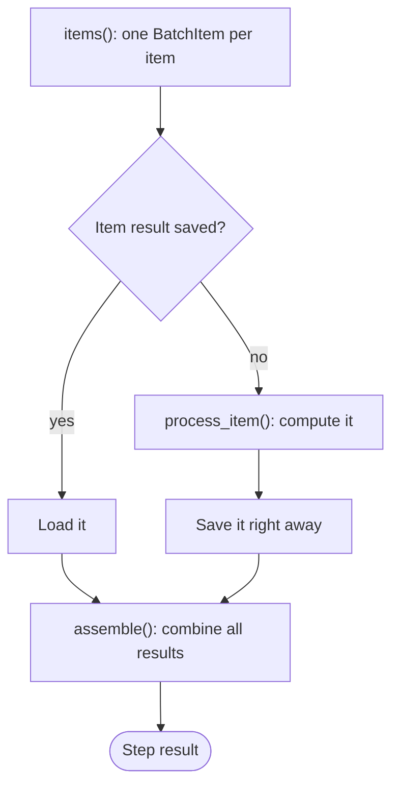

# Batch steps

Use `BatchStep` when a step does the same expensive call for many items. Each item's result
is cached on its own, so a rerun after a failure computes only the missing items.

Implement three methods:

1. `items(**inputs)`: return one `BatchItem(key=..., data=...)` per item.
2. `process_item(item, **inputs)`: compute one item.
3. `assemble(results, **inputs)`: combine the per-item results into the step result.

Instead of `items()`, you can implement `items_data()` and return plain data. adag then derives
each item key from three things: the step's own hash (class, code, fields), the item data, and
every other input of the step.

Set `items_source_keys` to the name of the input that holds the items, for example
`items_source_keys = ("names",)`. Without it, the whole list is part of every item key, so
adding one item recomputes all of them. The example in [Cache stores](cache-stores.md) sets it.

Override `process_batch()` to process items concurrently.

`BatchStep` runs in the process that calls `execute()`. It does not leave the machine. To run
items elsewhere, fan out over chunks of items with a `BatchStep` in each branch, and use a
[dispatcher](dispatch.md).

```python
--8<-- "docs/examples/batch.py"
```

```text
first run failed: API error for carol | called: ['alice', 'bob', 'carol']
second run called: ['carol', 'dave']
['hello alice', 'hello bob', 'hello carol', 'hello dave']
```



A crash loses only the item in progress: items already saved are loaded on the next run.

Item results live under `<cache_dir>/.items/<namespace>/`. The namespace is the class name in
snake case (`greet` above).
