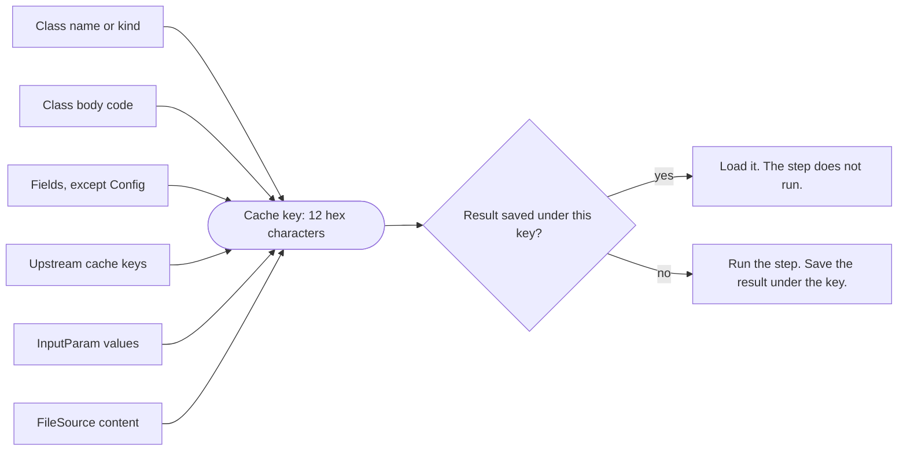

# Caching

Set `cache_dir` on the `Pipeline` and every step with a `BaseModel` result is cached there.
A step runs again only when its cache key changes.

## What is in the key

- The step class name, or its `kind` if it has one.
- The code of the step class body, as a syntax tree.
- Every dataclass field, except `Config` fields.
- The cache keys of upstream steps, `InputParam` values, and `FileSource` file content.

So a change to any of these recomputes that step and everything downstream. Nothing else
recomputes.



Example: a pipeline with four steps ran once. Then `Clean.case` changed. `Clean` and its
downstream step `Report` are pending (yellow). `Load` and `Count` stay cached (green).


The image comes from `dag(...)` on [`docs/examples/graph_states.py`](https://gitlab.com/cardona-oss/adag/-/blob/main/docs/examples/graph_states.py).

## Keep a field out of the key: Config

Wrap execution-only settings (worker counts, clients, timeouts) in `Config`. `run()` receives
the plain value.

```python
--8<-- "docs/examples/caching.py"
```

```text
Scale(factor=2, workers=Config(4))            ran: True
Scale(factor=2, workers=Config(4))            ran: False
Scale(factor=2, workers=Config(16))           ran: False
Scale(factor=3, workers=Config(4))            ran: True
```

## Equal nodes run once

Two nodes of one step class with the same cache key run once in a run, and both hand on the same
object. This holds with or without a cache, also for a result that is not saved, and across the
fan-out branches that run in the main process. A `LoopStep` round that starts from a state
already seen in the run is not run again.

The key leaves out `Config` fields and the fields that `strict_content_hash = False` skips. Two
nodes that differ only there share the result of the one that runs first. A random or side-effect
step is shared too. To run two nodes separately, give them a field that differs, such as
`sample: int`.

A node with no cache key runs on its own. Branches that a dispatcher runs on workers share results
only through the cache.

## Supported field types

Fields are hashed by `adag.hashing.encode_value`: `None`, `bool`, `int`, `float`, `str`,
`bytes`, `Enum`, `Path`, `UUID`, `type`, `BaseModel`, and `list`, `tuple`, `dict`, `set` of
those. A field of another type raises `UnhashableValueError`: wrap it in `Config`, or set
`strict_content_hash = False` on the class to skip such fields.

A `Path` field is hashed by its text. To hash a file's content, pass a `FileSource`.

## Limits

- Only the step's own class body is hashed. An edit to a base class or to a helper function
  the step calls does not change the key. Change a field or the `kind` version when it should.
- A comment, a blank line, formatting or a docstring edit does not change the key. Any other edit
  inside the class body does. `code_version` keeps the key through an edit that changes no result
  (see [cache keys](cache-keys.md#what-the-code-digest-covers)).
- A module constant that `run()` reads is not in the key. Make it a field.
- A step whose result is not a `BaseModel` is not cached, unless it overrides `save_result` and
  `load_result` (see below).
- Step keys are 12 hex characters (48 bits) of SHA-256. `BatchStep` item keys are 16 (64 bits).

## Why did a node recompute

Call `node.explain_key(params)`: it lists every component of the key with a digest. See
[Why a step recomputed](cache-keys.md).

## On disk

adag writes three entries per result, in this order:

- `<cache_dir>/<key>`: the result as JSON.
- `<cache_dir>/<key>.done`: the marker. A result without it is a miss.
- `<cache_dir>/.keys/<key>.json`: the key record (see
  [Why a step recomputed](cache-keys.md#key-records)).

An empty result file, or one that does not parse, is also a miss: the step runs again.
With `store=`, the same three keys go to the store (see [Cache stores](cache-stores.md)).

## Results that are not one JSON document

Override `save_result(result, path)` and `load_result(path)` to cache a result in your own
format: JSONL, a custom file, a file plus a sidecar, or a directory.

- `path` is `<cache_dir>/<key>`, where the key covers the step, its inputs and the run params.
- `save_result` creates `path` as a file or a directory. adag passes a temporary path and renames
  it into place, then writes `<key>.done`.
- `load_result` reads it back. Raise any exception to mark the entry invalid: the step runs again.
- Downstream steps always get the value `load_result` returns. On the first run too: adag saves
  the result, then hands on `load_result(path)`, not the value `run` returned.
- So `load_result` must rebuild everything `run` put in the result. A pydantic field marked
  `exclude=True` is lost unless `save_result` writes it to its own file.
- When the reloaded value differs from the one `run` returned, adag logs
  `step.load_result_differs`, once per step class.
- `node.is_cached(cache_dir, params)` calls `load_result` too, so it costs one load.
- Override both methods, or neither. Overriding one raises `TypeError` when the class is defined.
- These results live under `cache_dir`. A run with `store=` and no `cache_dir` raises before the
  step runs. `BatchStep` uses the same two methods for its assembled result.

```python
--8<-- "docs/examples/path_result.py"
```

```text
computing records
[{'i': 0}, {'i': 1}, {'i': 2}]
[{'i': 0}, {'i': 1}, {'i': 2}]
```

(output trimmed: log lines removed)

To port a deprecated `CachedStep` override: rename `save(self, result, cache_dir)` to
`save_result(self, result, path)` and write to `path` instead of `self.output_path(cache_dir)`.
Rename `load` to `load_result(self, path)`, and move the checks of `validate` into
`load_result` as exceptions. Each result is computed once more, under its new key.
