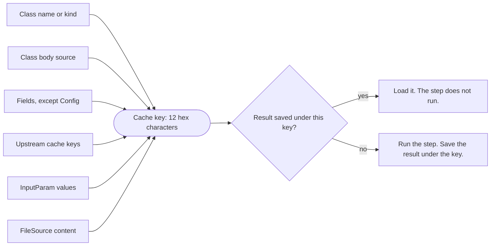

# Caching

Set `cache_dir` on the `Pipeline` and every step with a `BaseModel` result is cached there.
A step runs again only when its cache key changes.

## What is in the key

- The step class name, or its `kind` if it has one.
- The source code of the step class body.
- Every dataclass field, except `Config` fields.
- The cache keys of upstream steps, `InputParam` values, and `FileSource` file content.

So a change to any of these recomputes that step and everything downstream. Nothing else
recomputes.



Example: a pipeline with four steps ran once. Then `Clean.case` changed. `Clean` and its
downstream step `Report` are pending (yellow). `Load` and `Count` stay cached (green).



The image comes from `dag(...)` on [`docs/examples/graph_states.py`](https://gitlab.com/cardona-oss/adag/-/blob/main/docs/examples/graph_states.py).

## Keep a field out of the key: Config

Wrap execution-only settings (worker counts, clients, timeouts) in `Config`. `run()` receives
the plain value.

```python
--8<-- "docs/examples/caching.py"
```

```text
Scale(factor=2, workers=Config(4))            ran: True
Scale(factor=2, workers=Config(4))            ran: False
Scale(factor=2, workers=Config(16))           ran: False
Scale(factor=3, workers=Config(4))            ran: True
```

## Supported field types

Fields are hashed by `adag.hashing.encode_value`: `None`, `bool`, `int`, `float`, `str`,
`bytes`, `Enum`, `Path`, `UUID`, `type`, `BaseModel`, and `list`, `tuple`, `dict`, `set` of
those. A field of another type raises `UnhashableValueError`: wrap it in `Config`, or set
`strict_content_hash = False` on the class to skip such fields.

A `Path` field is hashed by its text. To hash a file's content, pass a `FileSource`.

## Limits

- Only the step's own class body is hashed. An edit to a base class or to a helper function
  the step calls does not change the key. Change a field or the `kind` version when it should.
- Any edit inside the class body changes the key, comments included.
- A step whose result is not a `BaseModel` is not cached, unless it overrides `save_result` and
  `load_result` (see below).
- Keys are 12 hex characters (48 bits) of SHA-256.

## Why did a node recompute

Call `explain_key(params)` on the node. It lists each component of the key, in the order adag
hashes them, with a 12-hex digest per component. Run it before and after a change: the
component whose digest differs is the cause.

```python
--8<-- "docs/examples/explain_key.py"
```

```text
Scale  key=9ba856cd8cc6  format=2
  identity  -        Scale         88caac9df9ad
  code      -        663765373931  3c5791a5408e
  field     factor   2             01e6dab02f90
  skipped   workers  Config(4)     -
  param     x        3             412a6e3e02d7
```

- An `upstream` component shows the upstream step and its key. Explain that node next to follow
  a change up the graph.
- `skipped` lists what is not in the key: `Config` fields and `node_label`.
- A missing input file blocks the key: `key` is `None` and `blocked_by` names the field.
- `format` is `adag.hashing.KEY_FORMAT`. A release that changes every key bumps it.
- `Pipeline.explain_keys(params)` explains every node, upstream nodes first.

## On disk

Each result is `<cache_dir>/<key>` (JSON) plus `<key>.done`, written after the result. A
result without its `.done` file, an empty file, or a file that does not parse is a miss.
After each save adag also writes a key record, `.keys/<key>.json`: the node's `explain_key`
output as JSON, with the adag version and the time. It is about 1 to 2 KB, holds field values
cut to 80 characters (never `Config` fields), and a failed write never fails the run. A later
release will use it to compare a new key with the one a result was saved under.
With `store=`, the same two keys go to the store (see [Cache stores](cache-stores.md)).

## Results that are not one JSON document

Override `save_result(result, path)` and `load_result(path)` to cache a result in your own
format: JSONL, a custom file, a file plus a sidecar, or a directory.

- `path` is `<cache_dir>/<key>`, where the key covers the step, its inputs and the run params.
- `save_result` creates `path` as a file or a directory. adag passes a temporary path and renames
  it into place, then writes `<key>.done`.
- `load_result` reads it back. Raise any exception to mark the entry invalid: the step runs again.
- Downstream steps get the value `load_result` returns, on a fresh run and on a cached run.
  On the first run too, adag saves the result and hands on `load_result(path)`, not the value
  `run` returned. So `load_result` must rebuild everything `run` put in the result, including a
  pydantic field marked `exclude=True` that `save_result` wrote to its own file. When the reloaded
  value differs from the one `run` returned, adag logs `step.load_result_differs` once per step
  class.
- Override both methods, or neither. Overriding one raises `TypeError` when the class is defined.
- These results live under `cache_dir`. A run with `store=` and no `cache_dir` raises before the
  step runs. `BatchStep` uses the same two methods for its assembled result.

```python
--8<-- "docs/examples/path_result.py"
```

```text
computing records
[{'i': 0}, {'i': 1}, {'i': 2}]
[{'i': 0}, {'i': 1}, {'i': 2}]
```

(output trimmed: log lines removed)

To port a deprecated `CachedStep` override: rename `save(self, result, cache_dir)` to
`save_result(self, result, path)` and write to `path` instead of `self.output_path(cache_dir)`.
Rename `load` to `load_result(self, path)`, and move the checks of `validate` into
`load_result` as exceptions. Each result is computed once more, under its new key.
