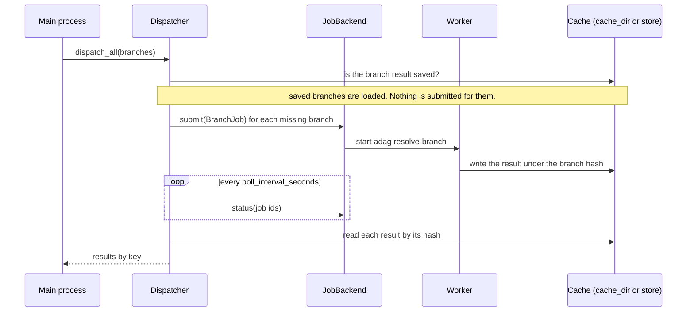

# Dispatch

A dispatcher decides where fan-out branches run. Workers write each result to the shared cache
under the branch content hash, and the main process reads it back by that hash. Only the job
description (`BranchJob`) crosses to the worker.

Dispatch is the only place where adag runs work outside the calling process. Everything else
(steps, `BatchStep`, thread pools, `aresolve_all`) runs in that process.



## Run branches in local processes

`SubprocessDispatcher` runs each branch in a new Python process, at most one per CPU at a time.

The pipeline must live in a file or an importable module. The `FanOutStep` names it and its
variable, so a worker can import it and rebuild the branch:

```python
--8<-- "docs/examples/dispatch_pipeline.py"
```

```python
--8<-- "docs/examples/dispatch.py"
```

```text
{'a': 2, 'b': 4, 'c': 6}
ran in other processes: True
```

- The pipeline needs a `cache_dir` or a `store`. With a `store`, also pass
  `store_url=` (see [Cache stores](cache-stores.md)), so workers open the same store.
- Params reach workers as JSON, so they must be JSON values. They show in the job command, so
  never pass secrets as params.
- A rerun after a failure submits only the failed keys: the others are already in the cache.

## Fan out over an upstream result

A fan-out with a `template` and a wired `over` (see [Fan-out](fan-out.md)) can run on any
dispatcher. Set `pipeline_module` and `fan_out_var` on the `FanOutStep`, as above. The
`fan_out_var` names the wired node, the result of `FanOutStep(...)(over=split)`.

```python
--8<-- "docs/examples/dispatch_template_pipeline.py"
```

```python
--8<-- "docs/examples/dispatch_template.py"
```

```text
{'part0': 6, 'part1': 19, 'part2': 4}
ran in other processes: True
{'part0': 6, 'part1': 19, 'part2': 8}
ran in other processes: True
```

The second run submitted one job: only `part2` changed.

How it works:

1. The main process resolves `over` and computes each branch hash from its item.
2. A job carries the branch key and `--expect-hash`. It does not carry the items.
3. The worker imports the file and resolves the `over` node again, with the same params.
4. It picks its item by key, builds the branch from the template, and checks the hash.

Notes:

- Step 3 reads the upstream result from the cache when the step saves its result with
  `save_result` (see [Save and load](save-load.md)). A step that returns a plain dict has no cache
  entry, so each worker runs it again. Keep that step cheap, or give it `save_result`.
- If the upstream step gives different items in the worker, the branch hash differs and the
  worker exits 2. It is not retried.
- A fan-out inside a branch runs in that worker, in its process. Only the fan-out named by
  `fan_out_var` is dispatched.
- Workers get params as JSON, as above. A param that only the upstream step uses is passed too.

## Retries and timeouts

`BranchPolicy` sets how hard to try each branch:

| Field | Default | Meaning |
|---|---|---|
| `max_retries` | 0 | extra attempts after a failure |
| `timeout_seconds` | None | limit from when the job is RUNNING |
| `queue_timeout_seconds` | None | limit while the job is PENDING |
| `poll_interval_seconds` | 5.0 | time between status calls |
| `retry_delay_seconds` | 0.0 | wait before a retry |
| `result_grace_seconds` | 5.0 | wait for the result after a job SUCCEEDED |
| `missing_status_polls` | 3 | polls that may leave a job out of `status()` before it counts as FAILED |

`SubprocessDispatcher()` with no policy polls every 0.05 s. If you pass a policy, set
`poll_interval_seconds=0.05` yourself, or local branches are polled every 5 s.

A worker exits 2 when it cannot find its branch, or when it derives a different branch hash than
the main process (`--expect-hash`). That means the worker runs different code. It is not retried.

## Run branches on a scheduler

`RemoteDispatcher(backend)` runs branches on any job scheduler. It checks the cache, submits up
to `max_concurrent` jobs, polls them, retries, applies timeouts, and cancels live jobs on an
error or Ctrl-C. On every poll it also looks in the cache. A branch whose result is already there
is done, even if its job is queued, running or failed, and the dispatcher cancels that job. A backend has three methods:

```python
class JobBackend(Protocol):
    def submit(self, job: BranchJob) -> str: ...  # start the job, return its id
    def status(self, job_ids: Sequence[str]) -> Mapping[str, JobStatus]: ...
    def cancel(self, job_ids: Sequence[str]) -> None: ...
```

Rules for a backend:

1. Run `job.command()` in an image that has the same pipeline code as the main process.
2. Use a module name (`pkg.pipeline`) as `pipeline_module`: a file path from your machine does
   not exist in a container.
3. Turn off the scheduler's own retries. `RemoteDispatcher` retries, and the attempts multiply.
4. Answer `status` for all ids in one call where the scheduler allows it.
5. Give the job access to the cache: a shared filesystem, or the store at `job.store_url`.
6. Report every submitted job in `status`, until it is SUCCEEDED or FAILED. A job left out of the
   answer for `missing_status_polls` polls in a row counts as FAILED and is cancelled.

`Resources(cpus=, memory_mb=, gpus=)` is passed on every `BranchJob`. `None` means the
scheduler's default.

Build the dispatcher and pass it to `execute()`. This uses the AWS Batch backend below:

```python
from adag.cache_store import store_from_url
from adag.dispatch import BranchPolicy, RemoteDispatcher, Resources

url = "postgresql://cache-host/adag"
pipeline = Pipeline(per_key, store=store_from_url(url))
dispatcher = RemoteDispatcher(
    AwsBatchBackend("my-queue", "adag-worker"),
    policy=BranchPolicy(max_retries=2, timeout_seconds=3600, queue_timeout_seconds=7200),
    resources=Resources(cpus=2, memory_mb=4096),
    max_concurrent=50,
    store_url=url,
)
pipeline.execute(dispatcher=dispatcher)
```

### AWS Batch

A recipe, not shipped and not run in CI:

```python
import boto3

from adag.dispatch import BranchJob, JobState, JobStatus

_STATES = {"SUCCEEDED": JobState.SUCCEEDED, "FAILED": JobState.FAILED, "RUNNING": JobState.RUNNING}


class AwsBatchBackend:
    def __init__(self, queue: str, job_definition: str) -> None:
        self.client = boto3.client("batch")
        self.queue = queue
        self.job_definition = job_definition

    def submit(self, job: BranchJob) -> str:
        r = job.resources
        wanted = [("VCPU", r.cpus), ("MEMORY", r.memory_mb), ("GPU", r.gpus or None)]
        requirements = [
            {"type": kind, "value": str(int(value))}  # Batch wants whole numbers: "2", not "2.0"
            for kind, value in wanted
            if value is not None
        ]
        response = self.client.submit_job(
            jobName=job.name(),
            jobQueue=self.queue,
            jobDefinition=self.job_definition,
            containerOverrides={
                "command": list(job.command()),
                "resourceRequirements": requirements,
            },
            retryStrategy={"attempts": 1},
        )
        return response["jobId"]

    def status(self, job_ids):
        out = {}
        for start in range(0, len(job_ids), 100):  # describe_jobs takes at most 100 ids
            for item in self.client.describe_jobs(jobs=list(job_ids[start : start + 100]))["jobs"]:
                state = _STATES.get(item["status"], JobState.PENDING)
                exit_code = item.get("container", {}).get("exitCode")
                out[item["jobId"]] = JobStatus(state, item.get("statusReason", ""), exit_code)
        return out

    def cancel(self, job_ids):
        for job_id in job_ids:
            self.client.terminate_job(jobId=job_id, reason="cancelled by adag")
```

### SLURM

A recipe, not shipped and not run in CI:

```python
import shlex
import subprocess

from adag.dispatch import BranchJob, JobState, JobStatus

_STATES = {
    "PENDING": JobState.PENDING,
    "RUNNING": JobState.RUNNING,
    "SUSPENDED": JobState.RUNNING,  # not final: the job resumes
    "RESIZING": JobState.RUNNING,
    "COMPLETED": JobState.SUCCEEDED,
}


class SlurmBackend:
    def submit(self, job: BranchJob) -> str:
        r = job.resources
        args = ["sbatch", "--parsable", "--no-requeue", f"--job-name={job.name()}"]
        if r.cpus is not None:
            args.append(f"--cpus-per-task={int(r.cpus)}")
        if r.memory_mb is not None:
            args.append(f"--mem={r.memory_mb}M")
        if r.gpus:
            args.append(f"--gres=gpu:{r.gpus}")
        args.append("--wrap=" + shlex.join(job.command()))
        return subprocess.run(args, capture_output=True, text=True, check=True).stdout.strip()

    def status(self, job_ids):
        lines = subprocess.run(
            ["sacct", "-n", "-X", "-P", "-o", "JobID,State,ExitCode", "-j", ",".join(job_ids)],
            capture_output=True, text=True, check=True,
        ).stdout.splitlines()
        out = {}
        for line in lines:
            job_id, state, exit_code = line.split("|")
            state = state.split()[0]  # "CANCELLED by 123" -> "CANCELLED"
            out[job_id] = JobStatus(
                _STATES.get(state, JobState.FAILED), state, int(exit_code.split(":")[0])
            )
        return out

    def cancel(self, job_ids):
        subprocess.run(["scancel", *job_ids], check=False)
```

## Known limits

- A shared upstream step that is not cached yet is computed by every worker that needs it.
  Run the pipeline up to that step first, or cache it before you dispatch.
- If the main process crashes, jobs that are still running are submitted again on the rerun.
  If an old job finishes first, the rerun finds its result in the cache and cancels the new job.
- A result that appears after the dispatcher has decided a branch failed is too late. The run
  raises `FanOutBranchError`, and the next run finds the result in the cache.
- A worker's stderr reaches you only through `JobStatus.detail`.
- `MemoryCacheStore`, a disk local to one machine, and SQLite on NFS cannot be the shared cache.
