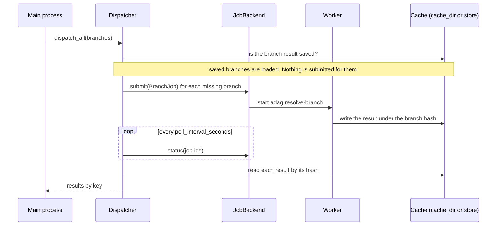

# Dispatch

A dispatcher decides where fan-out branches run. Workers write each result to the shared cache
under the branch content hash, and the main process reads it back by that hash. Only the job
description (`BranchJob`) crosses to the worker.

Dispatch is the only place where adag runs work outside the calling process. Everything else
(steps, `BatchStep`, thread pools, `aresolve_all`) runs in that process.



## Run branches in local processes

`SubprocessDispatcher` runs each branch in a new Python process, at most one per CPU at a time.

The pipeline must live in a file or an importable module. The `FanOutStep` names it and its
variable, so a worker can import it and rebuild the branch:

```python
--8<-- "docs/examples/dispatch_pipeline.py"
```

```python
--8<-- "docs/examples/dispatch.py"
```

```text
{'a': 2, 'b': 4, 'c': 6}
ran in other processes: True
```

- The pipeline needs a `cache_dir` or a `store`. With a `store`, also pass
  `store_url=` (see [Cache stores](cache-stores.md)), so workers open the same store.
- Params reach workers as JSON, so they must be JSON values. They show in the job command, so
  never pass secrets as params.
- A rerun after a failure submits only the failed keys: the others are already in the cache.

## Fan out over an upstream result

A fan-out with a `template` and a wired `over` (see [Fan-out](fan-out.md)) can run on any
dispatcher. Set `pipeline_module` and `fan_out_var` on the `FanOutStep`, as above. The
`fan_out_var` names the wired node, the result of `FanOutStep(...)(over=split)`.

```python
--8<-- "docs/examples/dispatch_template_pipeline.py"
```

```python
--8<-- "docs/examples/dispatch_template.py"
```

```text
{'part0': 6, 'part1': 19, 'part2': 4}
ran in other processes: True
{'part0': 6, 'part1': 19, 'part2': 8}
ran in other processes: True
```

The second run submitted one job: only `part2` changed.

How it works:

1. The main process resolves `over` and computes each branch hash from its item.
2. A job carries the branch key and `--expect-hash`. It does not carry the items.
3. The worker imports the file and resolves the `over` node again, with the same params.
4. It picks its item by key, builds the branch from the template, and checks the hash.

Notes:

- Step 3 reads the upstream result from the cache when the step saves its result with
  `save_result` (see [Save and load](save-load.md)). A step that returns a plain dict has no cache
  entry, so each worker runs it again. Keep that step cheap, or give it `save_result`.
- If the upstream step gives different items in the worker, the branch hash differs and the
  worker exits 2. It is not retried.
- A fan-out inside a branch runs in that worker, in its process. Only the fan-out named by
  `fan_out_var` is dispatched.
- Workers get params as JSON, as above. A param that only the upstream step uses is passed too.

## Retries and timeouts

`BranchPolicy` sets how hard to try each branch:

| Field | Default | Meaning |
|---|---|---|
| `max_retries` | 0 | extra attempts after a failure |
| `timeout_seconds` | None | limit from when the job is RUNNING |
| `queue_timeout_seconds` | None | limit while the job is PENDING |
| `poll_interval_seconds` | 5.0 | time between status calls |
| `retry_delay_seconds` | 0.0 | wait before a retry |
| `result_grace_seconds` | 5.0 | wait for the result after a job SUCCEEDED |
| `missing_status_polls` | 3 | polls that may leave a job out of `status()` before it counts as FAILED |
| `silent_timeout_seconds` | None | a RUNNING job whose worker wrote nothing for this long counts as FAILED (see below) |

`SubprocessDispatcher()` with no policy polls every 0.05 s. If you pass a policy, set
`poll_interval_seconds=0.05` yourself, or local branches are polled every 5 s.

A worker exits 2 when it cannot find its branch, or when it derives a different branch hash than
the main process (`--expect-hash`). That means the worker runs different code. It is not retried.

## Watch a branch while it runs

A worker reports to the main process through the same cache that carries the results. No extra
connection is needed. While a branch runs, the worker writes a small record under
`.events/<branch hash>`. The dispatcher reads it once per poll and sends each new event to your
observer's `on_event`.

```python
--8<-- "docs/examples/dispatch_events_pipeline.py"
```

```python
--8<-- "docs/examples/dispatch_events.py"
```

```text
a ['branch.step_start']
b ['branch.step_start']
```

Every event has `key` (the branch) and `attempt`, plus these fields:

| Event | Extra fields | When |
|---|---|---|
| `branch.step_start` | `step` | a step of the branch starts |
| `branch.step_cached` | `step` | a step is read from the cache |
| `branch.step_finished` | `step`, `seconds` | a step ran and its result was saved |
| `branch.event` | `name`, `fields` | the worker's own `on_event`, such as batch progress |
| `branch.failed` | `error_type`, `error` | the branch raised. The text also goes into the `FanOutBranchError` detail |

The default `LoggingObserver` prints them, so a long remote run shows progress in your terminal.

The record also tells the dispatcher that the worker is alive. A worker writes at least every
10 seconds. Set `silent_timeout_seconds` to cancel and retry a job that says RUNNING while its
machine is gone:

- It counts from the last sign of life. A worker that has not written yet is not silent, so a slow
  start (an image pull, a cold import, an upstream step in the worker) is covered by
  `timeout_seconds`.
- Use at least 30, and more on a network filesystem, which can show a new file late. A store that
  fails on write looks like a dead worker.
- The dispatcher uses its own clock, so the clocks of the machines do not need to agree.
- It needs a backend that reports RUNNING.

Limits:

- Events are best effort. The result can reach the cache before the worker reports its last
  events, so the last `step_finished` of a branch may never arrive.
- A record holds the newest 200 events. A worker that emits more between two polls loses the oldest.
- A rerun that reattaches to a live job (`find`) gets the events of that job again.
- A worker on an adag release before 0.3.44 writes no record, so you get no events and no silent
  check from it.
- The worker writes the record to the same cache as the result. A store that fails on write is
  logged, and the branch goes on.
- The worker deletes the record when it ends cleanly. After a failure it stays, and the dispatcher
  deletes it before the next attempt. A job cancelled right after its result can leave a record
  behind. It is small and harmless.

## Run branches on a scheduler

`RemoteDispatcher(backend)` runs branches on any job scheduler. It checks the cache, submits up
to `max_concurrent` jobs, polls them, retries, applies timeouts, and cancels live jobs on an
error or Ctrl-C. On every poll it also looks in the cache. A branch whose result is already there
is done, even if its job is queued, running or failed, and the dispatcher cancels that job.
A backend has three methods:

```python
class JobBackend(Protocol):
    def submit(self, job: BranchJob) -> str: ...  # start the job, return its id
    def status(self, job_ids: Sequence[str]) -> Mapping[str, JobStatus]: ...
    def cancel(self, job_ids: Sequence[str]) -> None: ...
```

Rules for a backend:

1. Run `job.command()` in an image that has the same pipeline code as the main process.
2. Use a module name (`pkg.pipeline`) as `pipeline_module`: a file path from your machine does
   not exist in a container.
3. Turn off the scheduler's own retries. `RemoteDispatcher` retries, and the attempts multiply.
4. Answer `status` for all ids in one call where the scheduler allows it.
5. Give the job access to the cache: a shared filesystem, or the store at `job.store_url`.
6. Report every submitted job in `status`, until it is SUCCEEDED or FAILED. A job left out of the
   answer for `missing_status_polls` polls in a row counts as FAILED and is cancelled.
7. Ship the code yourself. adag sends only the `BranchJob` (the command line). Building the
   image, copying files and installing dependencies are the backend's job.
8. Give the worker its credentials through its own environment. Only `store_url` crosses to the
   worker, as a command-line argument, so anyone who can list the scheduler's jobs can read it.
   Keep passwords out of the URL.
9. Results saved with `save_result(result, path)` are files under `cache_dir`. A dispatched branch
   gets a `cache_dir` only when the pipeline has no store, so such a step does not run in a
   dispatched branch of a pipeline that has a store.

`Resources(cpus=, memory_mb=, gpus=)` is passed on every `BranchJob`. `None` means the
scheduler's default. To size one fan-out differently, set `resources=` on its `FanOutStep`. It
replaces the dispatcher's `resources` for that fan-out, and it is not part of any cache key:

```python
FanOutStep(over=..., factory=..., resources=Resources(cpus=8, memory_mb=32768), ...)
```

### Optional methods

A backend may add three more methods. `RemoteDispatcher` uses each one that exists, so a backend
with only `submit`, `status` and `cancel` keeps working.

| Method | What the dispatcher does with it |
|---|---|
| `find(name) -> str \| None` | Before it submits a branch, asks for a job of an earlier run and reattaches to a live one. |
| `logs(job_id) -> str \| None` | When a branch fails, adds the last 2000 characters of the output to the error. |
| `close() -> None` | Calls it once when `dispatch_all` ends, also after an error or Ctrl-C. |

`find`:

- Submit every job under `job.name()`. `find` gets that name back.
- The name ends with the attempt number, so the dispatcher asks for each attempt that the policy
  allows. It reattaches to the latest job that is PENDING or RUNNING. It ignores finished jobs.
- The cache check comes first. A branch whose result is in the cache never calls `find`.
- A scheduler may still cancel an old job that timed out. The reattached job then fails, and the
  retry policy applies. `find` does not prevent that.
- A `find` that raises is logged, and the dispatcher submits a new job.
- `LocalJobBackend` has no `find`. Its jobs live in the Python process, so a restarted run knows
  none of them. `find` matters for a scheduler that outlives the dispatcher.

`logs` and `close`:

- `logs` may return `None`, for example while the job has no output yet. `LocalJobBackend` keeps
  the last 8000 characters of stderr of each failed job, until `close`.
- `close` must be safe to call twice, and the backend must work again if a later `dispatch_all`
  submits more jobs. A failing `close` is logged, and it does not replace the run's error.

This backend wraps `LocalJobBackend`, adds `find`, and reports a failed job with only its exit
code, as most schedulers do. The output of branch `b` reaches the error through `logs`:

```python
--8<-- "docs/examples/dispatch_failing_pipeline.py"
```

```python
--8<-- "docs/examples/dispatch_hooks.py"
```

```text
succeeded: ['a', 'c']
b: exit code 1
last output of job local-2:
error: row b has no value
{'find': 3, 'submit': 3, 'close': 1}
```

A backend that starts a server makes it on the first `submit` and deletes it in `close`.
A sketch, not run in CI (`cloud` stands for your provider's client):

```python
class ServerBackend:
    def __init__(self, cloud) -> None:
        self.cloud = cloud
        self.server = None

    def submit(self, job: BranchJob) -> str:
        if self.server is None:
            self.server = self.cloud.create_server()  # on first use, not in __init__
        return self.server.start(list(job.command()), name=job.name())

    def close(self) -> None:
        if self.server is not None:  # safe to call twice
            self.server.delete()
            self.server = None
```

Build the dispatcher and pass it to `execute()`. This uses the AWS Batch backend below:

```python
from adag.cache_store import store_from_url
from adag.dispatch import BranchPolicy, RemoteDispatcher, Resources

url = "postgresql://cache-host/adag"
pipeline = Pipeline(per_key, store=store_from_url(url))
dispatcher = RemoteDispatcher(
    AwsBatchBackend("my-queue", "adag-worker"),
    policy=BranchPolicy(max_retries=2, timeout_seconds=3600, queue_timeout_seconds=7200),
    resources=Resources(cpus=2, memory_mb=4096),
    max_concurrent=50,
    store_url=url,
)
pipeline.execute(dispatcher=dispatcher)
```

### CommandBackend

`CommandBackend` is a `JobBackend` made from command templates. Use it when the scheduler has a
CLI (`sbatch`, `kubectl`, `gcloud`, `vastai`, `modal`, `ssh`) and you do not want to write a
class. It runs each command with no shell, so a branch key or a parameter never reaches a shell
parser.

```python
from adag.backends import CommandBackend
from adag.dispatch import JobState

backend = CommandBackend(
    submit_command=["sbatch", "--parsable", "--job-name={name}", "--wrap={command_line}"],
    status_command=["scripts/job-state", "{job_id}"],  # your script: prints RUNNING, DONE or FAIL
    cancel_command=["scancel", "{job_id}"],
    states={"RUNNING": JobState.RUNNING, "DONE": JobState.SUCCEEDED, "FAIL": JobState.FAILED},
)
```

Each template is a list of arguments. The placeholders:

| Template | Placeholders |
|---|---|
| `submit_command` | `{command}`, `{command_line}`, `{name}`, `{cpus}`, `{memory_mb}`, `{gpus}` |
| `status_command`, `cancel_command`, `logs_command` | `{job_id}` |
| `find_command` | `{name}` |
| `close_command` | none |

- `{command}` as a whole argument becomes the worker's arguments. Use it when the program takes
  the command as separate arguments.
- `{command_line}` is the worker command as one quoted text. Use it for `ssh` and `sbatch --wrap`,
  which hand the text to a POSIX shell.
- An unset resource becomes an empty text. Write `{{` for a literal brace.
- An unknown placeholder raises `ValueError` when you build the backend.

What each command must do:

1. `submit_command` exits 0 and prints the job id as its last non-empty line.
2. `status_command` prints the state as its first word. The word must be a key of `states`. An
   optional second word is the exit code, and the rest is the detail. A scheduler CLI that prints
   something else needs a small wrapper script that prints one word.
3. `cancel_command` may fail. The job may have ended already, and adag only logs it.
4. `find_command` (optional) prints the id of the job submitted under `{name}`. If you set it,
   `submit_command` must contain `{name}`.
5. `logs_command` (optional) prints the output of the job.
6. `close_command` (optional) runs once after a submit, when the dispatcher ends. Use it to delete
   a machine. It must be safe to run twice.

A status call that fails, times out or prints an unknown word leaves the job out of the answer.
`missing_status_polls` then decides when the job counts as FAILED, so one slow call does not fail
a branch. Every command has `command_timeout_seconds` (60 by default).

Put secrets in `env=`, not in a template. A template shows in `ps` and in scheduler consoles.
The commands run with the environment of the main process plus `env`.

`CommandBackend` runs one status process per job on each poll. That is fine for tens of jobs. For
hundreds, write a backend that asks the scheduler once, as the AWS Batch recipe does.

### AWS Batch

A recipe, not shipped and not run in CI:

```python
import boto3

from adag.dispatch import BranchJob, JobState, JobStatus

_STATES = {"SUCCEEDED": JobState.SUCCEEDED, "FAILED": JobState.FAILED, "RUNNING": JobState.RUNNING}


class AwsBatchBackend:
    def __init__(self, queue: str, job_definition: str) -> None:
        self.client = boto3.client("batch")
        self.queue = queue
        self.job_definition = job_definition

    def submit(self, job: BranchJob) -> str:
        r = job.resources
        wanted = [("VCPU", r.cpus), ("MEMORY", r.memory_mb), ("GPU", r.gpus or None)]
        requirements = [
            {"type": kind, "value": str(int(value))}  # Batch wants whole numbers: "2", not "2.0"
            for kind, value in wanted
            if value is not None
        ]
        response = self.client.submit_job(
            jobName=job.name(),
            jobQueue=self.queue,
            jobDefinition=self.job_definition,
            containerOverrides={
                "command": list(job.command()),
                "resourceRequirements": requirements,
            },
            retryStrategy={"attempts": 1},
        )
        return response["jobId"]

    def status(self, job_ids):
        out = {}
        for start in range(0, len(job_ids), 100):  # describe_jobs takes at most 100 ids
            for item in self.client.describe_jobs(jobs=list(job_ids[start : start + 100]))["jobs"]:
                state = _STATES.get(item["status"], JobState.PENDING)
                exit_code = item.get("container", {}).get("exitCode")
                out[item["jobId"]] = JobStatus(state, item.get("statusReason", ""), exit_code)
        return out

    def cancel(self, job_ids):
        for job_id in job_ids:
            self.client.terminate_job(jobId=job_id, reason="cancelled by adag")

    # Optional: lets a rerun reattach to a job that an earlier run left alive.
    def find(self, name):
        # With a JOB_NAME filter, list_jobs returns jobs of any status, newest first.
        filters = [{"name": "JOB_NAME", "values": [name]}]
        jobs = self.client.list_jobs(jobQueue=self.queue, filters=filters)["jobSummaryList"]
        return jobs[0]["jobId"] if jobs else None

    # Optional: the end of a failed job's output goes into the error.
    def logs(self, job_id):
        container = self.client.describe_jobs(jobs=[job_id])["jobs"][0].get("container", {})
        stream = container.get("logStreamName")
        if stream is None:  # the job never started
            return None
        events = boto3.client("logs").get_log_events(  # the default log group of Batch jobs
            logGroupName="/aws/batch/job", logStreamName=stream, limit=50, startFromHead=False
        )["events"]
        return "\n".join(event["message"] for event in events)
```

### SLURM

A recipe, not shipped and not run in CI:

```python
import shlex
import subprocess
from pathlib import Path

from adag.dispatch import BranchJob, JobState, JobStatus

_STATES = {
    "PENDING": JobState.PENDING,
    "RUNNING": JobState.RUNNING,
    "SUSPENDED": JobState.RUNNING,  # not final: the job resumes
    "RESIZING": JobState.RUNNING,
    "COMPLETED": JobState.SUCCEEDED,
}


class SlurmBackend:
    def submit(self, job: BranchJob) -> str:
        r = job.resources
        args = ["sbatch", "--parsable", "--no-requeue", f"--job-name={job.name()}"]
        args.append("--output=adag-%j.log")  # %j is the job id: logs() reads this file
        if r.cpus is not None:
            args.append(f"--cpus-per-task={int(r.cpus)}")
        if r.memory_mb is not None:
            args.append(f"--mem={r.memory_mb}M")
        if r.gpus:
            args.append(f"--gres=gpu:{r.gpus}")
        args.append("--wrap=" + shlex.join(job.command()))
        return subprocess.run(args, capture_output=True, text=True, check=True).stdout.strip()

    def status(self, job_ids):
        lines = subprocess.run(
            ["sacct", "-n", "-X", "-P", "-o", "JobID,State,ExitCode", "-j", ",".join(job_ids)],
            capture_output=True, text=True, check=True,
        ).stdout.splitlines()
        out = {}
        for line in lines:
            job_id, state, exit_code = line.split("|")
            state = state.split()[0]  # "CANCELLED by 123" -> "CANCELLED"
            out[job_id] = JobStatus(
                _STATES.get(state, JobState.FAILED), state, int(exit_code.split(":")[0])
            )
        return out

    def cancel(self, job_ids):
        subprocess.run(["scancel", *job_ids], check=False)

    # Optional: lets a rerun reattach to a job that an earlier run left alive.
    def find(self, name):
        found = subprocess.run(
            ["sacct", "-n", "-X", "-P", "-S", "now-7days", "-o", "JobID", f"--name={name}"],
            capture_output=True, text=True, check=True,
        ).stdout.split()
        return found[-1] if found else None  # the newest job with that name

    # Optional: the end of a failed job's output goes into the error.
    def logs(self, job_id):
        path = Path(f"adag-{job_id}.log")  # written by sbatch --output in the submit directory
        return path.read_text(errors="replace") if path.exists() else None
```

## Run from your laptop on cloud machines

A worker on another machine needs two things: the pipeline code, and a cache it can reach.
The cache is the hard part. The main process and every worker must read and write the same one.

| Cache | Reachable from another machine |
|---|---|
| `SqlCacheStore` (Postgres, MySQL) | yes |
| `RedisCacheStore` | yes |
| `FileSystemCacheStore` on a shared filesystem | yes, if every machine mounts it |
| `SqliteCacheStore`, a local disk, `MemoryCacheStore` | no |

adag has no S3 or Google Cloud Storage cache yet. Use a SQL or Redis URL that both your laptop and
the cloud machines can reach, and pass it as `store_url`. The URL goes to the worker on its command
line, so keep the password out of it (rule 8 above).

Checklist for a machine that you start per job:

1. Build an image that has the same pipeline code as your laptop (rules 1, 2 and 7 above).
2. Pass the cache URL as `store_url`.
3. Set a maximum lifetime on the machine when you create it. If your laptop sleeps or the main
   process is killed, `close` never runs, and the machine would run and bill until you stop it.
4. Submit each job under `job.name()` and add `find`, so a rerun reattaches to a live job instead
   of starting a second one.

A branch that fails on a machine reaches you through `JobStatus.detail` and `logs`. adag reads the
result from the cache, not from the job's exit code.

## Known limits

- A shared upstream step that is not cached yet is computed by every worker that needs it.
  Run the pipeline up to that step first, or cache it before you dispatch.
- If the main process crashes, a backend without `find` submits the branches again on the rerun.
  If an old job finishes first, the rerun finds its result in the cache and cancels the new job.
  A backend with `find` reattaches to the old jobs instead.
- A result that appears after the dispatcher has decided a branch failed is too late. The run
  raises `FanOutBranchError`, and the next run finds the result in the cache.
- A worker's output reaches you through `JobStatus.detail`, and through `logs` when the backend
  has it.
- `MemoryCacheStore`, a disk local to one machine, and SQLite on NFS cannot be the shared cache.
- A `save_result(result, path)` step does not run in a dispatched branch when the pipeline has a
  store (rule 9). Large files cannot cross machines yet.
- `close` runs once per `dispatch_all`. A `LoopStep` with a dispatched fan-out calls it every round,
  so a backend that starts a machine in `submit` starts a new one each round.
