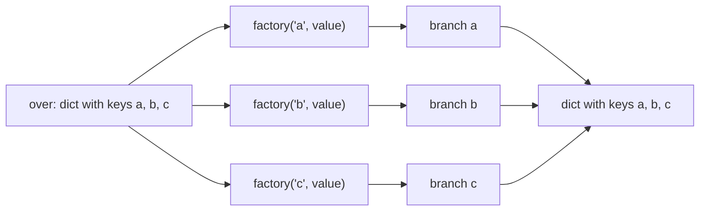
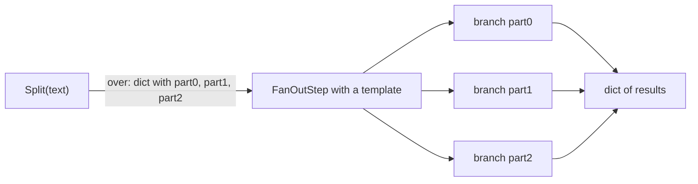

# Fan-out

`FanOutStep` builds one sub-graph per key of a dict and returns a dict of results with the
same keys. Each branch is cached like any other step.

- `over`: the dict to iterate. With a `template`, it can be the result of an upstream step.
- `factory(key, value)`: returns the branch's `StepResult`. Use it when the keys are known when
  you build the graph.
- `template`: a [`Template`](#template) that builds each branch. Use it when the keys come from
  an upstream step.
- `max_workers`: deprecated, removed in 1.0. Use `max_concurrency` and `runs_on` instead (see
  [Async and parallel](async-parallel.md)).

Give exactly one of `factory` and `template`.



```python
--8<-- "docs/examples/fan_out.py"
```

```text
{'intro': 6, 'body': 19, 'end': 4}
```

## Fan out over an upstream result

Use a `template` and wire `over` to a step that returns a dict. The step decides the keys,
so the number of branches is known only when the run reaches the fan-out.

1. Write a function `build(key, item)` that returns the branch's `StepResult`.
2. Wrap it: `Template(build=build)`.
3. Wire the upstream step: `FanOutStep(template=...)(over=split)`.



```python
--8<-- "docs/examples/fan_out_template.py"
```

```text
{'part0': 6, 'part1': 19, 'part2': 4} measured: ['Hello.', 'A longer paragraph.', 'Bye.']
{'part0': 6, 'part1': 19, 'part2': 4} measured: []
{'part0': 6, 'part1': 19, 'part2': 8} measured: ['See you.']
```

Each branch is cached under the key of the sub-graph built for its item. The second run found
every branch in the cache. In the third run only `part2` changed, so only `part2` ran.

An upstream step that runs again and returns the same items also finds every branch in the
cache. The key of a branch does not include the dict key, unless `build` passes `key` to a step.

Rules for the items:

- Each item must be a `BaseModel` or JSON-like data (str, number, list, dict). Anything else
  raises `UnhashableValueError` before the first branch runs.
- Two keys that give the same text, such as `1` and `"1"`, raise `ValueError`.
- `over` must resolve to a dict.

A fan-out with a `template` runs in the calling process. To run its branches in worker processes, see
[Fan out over an upstream result](dispatch.md#fan-out-over-an-upstream-result) in Dispatch.

## Template

A `Template` is a sub-graph with named inputs: a function `build` and the names of its
arguments. `FanOutStep` needs two inputs, `("key", "item")`, which is the default.

adag calls `build` twice:

1. Once with placeholders, to hash the graph. This gives the template hash, which goes into
   the key of the fan-out node. It does not depend on any item.
2. Once per item with the real values, to get the sub-graph that runs for that item.

So `build` can pass `key` and `item` to a step, as a field or as an input. It must not read
them: no `item.upper()`, no `if item`, no `len(item)`, no f-string. A placeholder raises
`TemplateInputError` on any such use.

```text
adag.hashing.TemplateInputError: template input 'item' was used as a value (.upper). A template
is built once, with placeholders, to hash its graph. Pass the input to a step as a field or an
input and let the step read it.
```

Move the logic into a step. The step receives the real value in `run()`.

## Failures

A failing branch raises its own exception and stops the fan-out. With a dispatcher, the other
branches still finish, and the fan-out raises `FanOutBranchError`: its `failed` dict maps each
failed key to the error. To run branches in separate processes or on a scheduler, see
[Dispatch](dispatch.md).
