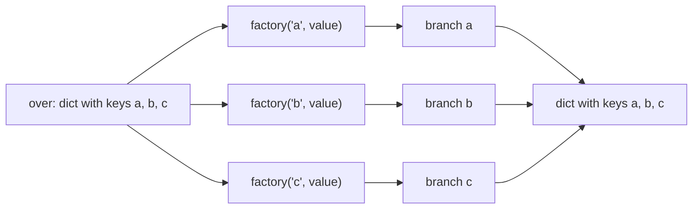

# Fan-out

`FanOutStep` builds one sub-graph per key of a dict and returns a dict of results with the
same keys. Each branch is cached like any other step.

- `over`: the dict to iterate.
- `factory(key, value)`: returns the branch's `StepResult`.
- `max_workers`: run branches on a thread pool of this size. The default runs them one by one.



```python
--8<-- "docs/examples/fan_out.py"
```

```text
{'intro': 6, 'body': 19, 'end': 4}
```

A failing branch raises its own exception and stops the fan-out. With a dispatcher, the other
branches still finish, and the fan-out raises `FanOutBranchError`: its `failed` dict maps each
failed key to the error. To run branches in separate processes or on a scheduler, see
[Dispatch](dispatch.md).
