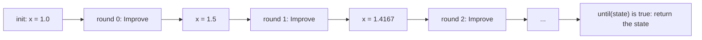

# Loops

Use `LoopStep` to run a sub-graph again and again, each round starting from the result of the
one before, until a condition holds. The graph stays acyclic: the loop is one node, and its
rounds are built when the run reaches it.

1. Write a function that builds one round from the state: `one_round(state)`.
2. Wrap it in a [`Template`](fan-out.md#template) with the input `("state",)`.
3. Write the stop test, `until(state) -> bool`, as a function at module level.
4. Wire the start state: `LoopStep(...)(init=node)`.

```python
--8<-- "docs/examples/loop_newton.py"
```

```text
stopped after 3 rounds, x = 1.414216, ran 3
x = 1.414213562373 after 2 new rounds
rerun: 0 new rounds
```

The first run had `max_rounds=3` and raised `LoopNotConverged`. The second run had
`max_rounds=20`. It found rounds 0 to 2 in the cache and ran only two new rounds.



## When the loop stops

The loop stops at the first of these:

1. `until(state)` is true. It is tested on the start state too, so a loop can run zero rounds.
2. A round returns the state it was given (a fixed point). The loop returns that state.
3. `max_rounds` rounds have run. It raises `LoopNotConverged`, which has `rounds` and `state`.
   Pass `on_max="return"` to get the last state instead.

## What a round is cached under

Round `n` is cached under the key of the sub-graph that `one_round` builds over the state it
starts from. The key does not include the round number or `max_rounds`.

- A rerun finds every finished round in the cache.
- A loop that crashed continues after its last cached round.
- Raising `max_rounds` reuses the rounds that ran.
- An upstream step that runs again and returns the same start state hits every round.

The key of the loop node covers the template hash, the key of `init`, the name of `until`,
`until_version`, `max_rounds`, `on_max` and `key_by_round`. Change `until_version` when the
behaviour of `until` changes, because adag hashes its name and not its code.

## Retry until it works

The same state gives the same round key, so the cache returns the same result. A step that
fails now and works on the second try never gets a second try: its result is cached, and the
state did not change, so the loop stops at the fixed point.

For this, set `key_by_round=True` and give the template two inputs, `("state", "round")`.
Pass `round` to a step as a field or an input. Each round then has its own key, and the fixed
point stop is off.

## Rules for the state

- The state must be a `BaseModel` or JSON-like data. adag hashes it to tell whether a round
  changed it. Anything else raises `UnhashableValueError`.
- `until` must be a function defined at module level. A lambda or a nested function raises
  `TypeError`: its name does not identify it.
- `build` must not read the state. Pass it to a step. See [Template](fan-out.md#template).

## Combine with fan-out

A loop can sit inside a fan-out branch, and a fan-out can sit inside a loop body. Both run in
the calling process.

```python
--8<-- "docs/examples/loop_in_fan_out.py"
```

```text
{'a': 5, 'b': 3}
```

## Draw and inspect

- `dag()` draws one dashed `loop` box. Its `each round` line lists the steps of the body.
- `explain_key` shows an `expansion` row: `up to N rounds; each round is cached under the key
  of the state it starts from`. The rounds are not listed there, because their keys depend on
  states that exist only after the run. Each round writes its own key record when it runs.
- An observer gets `on_loop_round(number, key)` before each round. `RunTreeObserver` labels
  the round's steps `[round 0]`, `[round 1]`.

## Limits

- A loop runs in the calling process. A dispatcher does not send its rounds to workers.
- To loop inside a loop, put a `LoopStep` in the body of another one.
