# Static and dynamic parts

This page says which part of a pipeline is fixed and which part is decided at run time. Read it
before [Fan-out](fan-out.md) and [Loops](loops.md): both build on it.

## The two parts

A normal step is static. You know it, and its cache key, before the run.

A `FanOutStep` or a `LoopStep` has a static part and a dynamic part:

- Static: the **template**. It is the sub-graph that one branch or one round runs.
- Dynamic: how many times the template runs. A fan-out runs it once per item. A loop runs it once
  per round, until its stop test is true.

The node that builds the sub-graph at run time has an **expansion**. `step.expansion()` returns an
`Expansion`, or `None` for a step with no template.

## Words used in these docs

| Word | Meaning |
| --- | --- |
| Template | A function that builds a sub-graph, plus the names of its inputs: `Template(build=..., inputs=...)`. |
| Template input | A name the template receives. A fan-out gives `key` and `item`. A loop gives `state` (and `round` with `key_by_round`). |
| Fan-out | A node that runs its template once for each item of a dict. |
| Branch | One run of the template of a fan-out, for one item. |
| Item | One value of the dict a fan-out runs over. |
| Loop | A node that runs its template again and again over its own result. |
| Round | One run of the template of a loop. |
| State | What a round returns and the next round starts from. |
| Expansion | What a step tells adag about its template: the shape, the template, the inputs it feeds. |
| Frame | How `dag()` draws an expansion: a dashed box around the template, drawn once. |

## What is in the cache key

- The template is in the key of the fan-out or the loop. Change its code, a field of its steps or
  an upstream, and the key changes.
- The number of branches or rounds is not in the key. It is a result of the run.
- Each branch and each round has its own key, from its template and its input. A rerun reuses the
  ones that did not change.

`explain_key` shows an `expansion` row with the shape and a note. The key record of a run lists the
key of each branch or round as `expansion.children` (see [Why a step recomputed](cache-keys.md)).

## What `dag()` draws

`dag()` draws the template once, inside a frame. It does not draw one copy per item or round,
because the count is known only when the run reaches the node.

- Template inputs are at the top of the frame.
- One edge leaves the bottom.
- A loop has no real edge back, so a dashed "next round" arrow returns to `state`.
- With `cache_dir=`, the caption counts the cached branches or rounds.

See [Visualization](visualization.md) for the options.

## What you can ask a pipeline

- `pipeline.expansions()` lists the steps that have a template, and the steps of each template.
- `pipeline.validate()` also checks the steps inside each template, so a missing input fails before
  the run reaches it.
- `walk(output, expand=True)` gives the template steps as children of their node.

## One rule for the template

The build function receives placeholders when adag hashes it. Pass them on to steps. Do not read
them: a build that branches on a value would hash to something wrong for the real values, and adag
raises `TemplateInputError`. Put the decision in a step, not in the build function.
