# Visualization

`dag(output)` renders the graph to SVG. With `cache_dir`, each step is colored by its state:
cached (green), pending (yellow), or blocked (red, the step has no key, for example a
`FileSource` field whose file is missing).

```python
--8<-- "docs/examples/visualization.py"
```


`dag` takes no run params. It computes each key with the `InputParam` defaults, not with the
values of your last run. A step that depends on a required `InputParam` shows as pending even
after a run.

Here a pipeline ran once, then the `case` field of `Clean` changed. `Clean` and `Report` are
pending (yellow). `Load` and `Count` are still cached (green).



In a notebook, the returned `SVG` object displays inline. Use `SvgOptions` to change the theme
or hide the per-step parameters.

## Draw the graph your own way

1. `walk(output)` returns the `Node` and `Edge` lists.
2. `node_metadata(nodes, cache_dir=, prefix=)` returns one `NodeMetadata` per node: what `dag`
   would draw.
3. Change the ones you want with `dataclasses.replace`.
4. `render_graph_svg(metadata, pairs)` returns the SVG text. `pairs` are `(source, target)` names.

```python
--8<-- "docs/examples/custom_drawing.py"
```

```text
[('Square', 'step', 'PENDING'), ('x', 'param', 'SOURCE')]
str True
```

- `compute_state(node, cache_dir)` returns `CACHED`, `PENDING`, `BLOCKED` or `SOURCE` for one node.
- `render_graph_svg` returns `str`. `dag` returns an `SVG` object; `str(svg)` is the SVG text.
- `Node`, `Edge`, `NodeMetadata`, `compute_state`, `node_metadata` and `render_graph_svg` import
  from `adag`. Their names and fields stay stable. The old private name `_render_graph_svg`
  works until 1.0.
