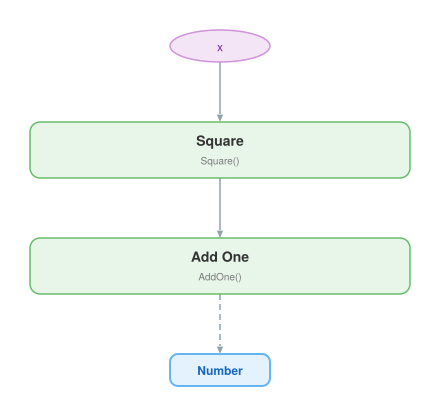

# Visualization

`dag(output)` draws the graph as SVG. Pick a look with `SvgOptions`, or restyle it from your page
with CSS variables.

```python
--8<-- "docs/examples/visualization.py"
```



Each step is a box. The state square and word say whether the step is cached, pending or
blocked. The box also shows the 12-character cache key of the step (`key 4ac3b3f08cb0`). Run
`dag(output, cache_dir=...)` to see the states. Without `cache_dir` there is no state to show,
so the boxes are neutral and carry no state word.

- `cached`: a complete result is in the cache.
- `pending`: the step has no result yet, or one of its inputs changed.
- `blocked`: the step has no key, for example a `FileSource` field whose file is missing.

`dag` takes no run params. It computes each key with the `InputParam` defaults, not with the
values of your last run. A step that depends on a required `InputParam` shows as pending even
after a run.

Here a pipeline ran once, then one input changed. `Clean` and `Report` are pending. `Load` and
`Count` are still cached.


A node that builds its sub-graph at run time has a dashed border. A `FanOutStep` with a
`template` is `mapped` (long dashes): the box says "one branch per item", and its `each item`
line lists the steps of the template. A `LoopStep` is `loop` (short dashes) and its `each round`
line lists the steps of its body. The graph shows one box, not one per item or round, because the
count is not known until the run reaches the node.

In a notebook, the returned `SVG` object displays inline.

## Choose a look

`SvgOptions` has three fields that change how the graph looks. Each has a default, so
`SvgOptions()` is the blueprint look with input nodes.

| Field | Values | What it does |
| --- | --- | --- |
| `style` | `"blueprint"` (default), `"band"`, `"classic"` | The look of the boxes and edges. |
| `inputs` | `"terminals"` (default), `"tabs"`, `"rows"` | Where `InputParam` and file inputs go. |
| `density` | `"normal"` (default), `"compact"` | How much each box shows. |
| `theme` | `"light"` (default), `"dark"`, `"auto"` | The default colours. `"auto"` follows the browser. |
| `legend` | `False` (default) | Add a row under the graph that names the state colours. |
| `animate` | `False` (default) | Move dashes along the edges into pending steps. |
| `show_params` | `True` (default) | Draw the scalar fields of each step. |
| `include_styles` | `True` (default) | Put the stylesheet in the SVG. |
| `include_background` | `True` (default) | Draw the background (and the grid in blueprint). |

The images below come from `docs/examples/graph_looks.py`. Run `scripts/gen-docs-graphs` to draw
them again.

### Style

`blueprint` has mono type, square corners, a faint grid and right-angle edges. The footer of
each box has the state and the cache key.



`band` has a header strip with the title and the state word, and curved edges.



`classic` is the look of adag 0.3.22: centred text in rounded boxes. Use it to keep the old
images. It always draws inputs as nodes.



### Inputs

`terminals` draws each input as a small node with an edge into the step. This is the clearest
view of how the graph is wired.

`tabs` folds each input into the step that reads it, as a tab on the top edge. Several inputs
make several tabs.



`rows` folds each input into one line inside the step.



A box lists at most six input lines. The sixth says `+N more` when there are more.

### Density

`density="compact"` draws only the title of each step. The description, the parameters, the
state and the key move to the hover tooltip. Inputs become labels to the left of the step.



### Dark theme

`theme="dark"` swaps the default colours. `legend=True` adds the row at the bottom.



## Restyle it from your page

Every colour is a CSS variable with a default, `var(--adag-edge, #607d8b)`. Set `--adag-*` on any
parent element of an inline SVG, and the graph uses your value.

```html
<style>
  .pipeline {
    --adag-edge: #2b6a8a;
    --adag-cached: #0f9d9a;
    --adag-pending: #e07a00;
    --adag-ink: #0b4f6c;
  }
</style>
<div class="pipeline">
  <!-- paste the SVG text here, or put it in the page with your template engine -->
</div>
```

With mkdocs-material, map the variables to the theme colours in `docs/stylesheets/extra.css`, so
the graph follows light and dark mode:

```css
:root {
  --adag-canvas: var(--md-default-bg-color);
  --adag-card: var(--md-default-bg-color);
  --adag-text: var(--md-default-fg-color);
  --adag-muted: var(--md-default-fg-color--light);
  --adag-edge: var(--md-default-fg-color--light);
  --adag-ink: var(--md-primary-fg-color);
  --adag-paper: var(--md-default-bg-color);
  --adag-grid: var(--md-default-fg-color--lightest);
}
```

Two rules about where this works:

- The variables work only when the SVG is inline in the page. In `` or
  `` the SVG is a separate document, and it uses its own defaults.
- A README on GitHub, GitLab or PyPI shows an image, not inline SVG. Save the graph to a file
  with `dag(output, path="graph.svg")` and link it as ``. Do not paste the SVG text.

To own every colour, pass `SvgOptions(include_styles=False)`. The SVG keeps its classes and
data attributes and has no `<style>` element.

### The variables

| Variable | Light | Dark | What it paints |
| --- | --- | --- | --- |
| `--adag-canvas` | `#ffffff` | `#14161a` | The background behind the graph. |
| `--adag-card` | `#ffffff` | `#1c242d` | The body of a step in the band style. |
| `--adag-text` | `#333333` | `#e6e8eb` | Titles and other main text. |
| `--adag-muted` | `#5f6368` | `#a3aab2` | Descriptions, parameters and the cache key. |
| `--adag-edge` | `#607d8b` | `#8a96a3` | Edges and arrowheads (classic and band). |
| `--adag-step-bg` | `#f6f8fa` | `#1d2127` | A step with no cache state (no `cache_dir`). |
| `--adag-step-border` | `#78909c` | `#6b7683` | The border of a step with no cache state. |
| `--adag-neutral` | `#64748b` | `#8795a4` | The state square of a step with no cache state. |
| `--adag-cached` | `#2a9456` | `#4cc283` | The state square of a cached step. |
| `--adag-pending` | `#c98e00` | `#e3b341` | The state square of a pending step. |
| `--adag-blocked` | `#d0413a` | `#ef6b63` | The state square of a blocked step. |
| `--adag-cached-ink` | `#1b6b3a` | `#7dd9a5` | The word CACHED. |
| `--adag-pending-ink` | `#8a6200` | `#f0c75a` | The word PENDING. |
| `--adag-blocked-ink` | `#b3261e` | `#f5918b` | The word BLOCKED. |
| `--adag-cached-bg` | `#e8f5e9` | `#16261a` | A cached step: classic fill, band header. |
| `--adag-pending-bg` | `#fff8e1` | `#2a2317` | A pending step: classic fill, band header. |
| `--adag-blocked-bg` | `#ffebee` | `#2d1a1c` | A blocked step: classic fill, band header. |
| `--adag-cached-border` | `#66bb6a` | `#4f9a5b` | A cached step: classic and band border. |
| `--adag-pending-border` | `#ffc107` | `#b58900` | A pending step: classic and band border. |
| `--adag-blocked-border` | `#ef5350` | `#d05a5a` | A blocked step: classic and band border. |
| `--adag-leaf-bg` | `#e8eaf6` | `#1e2030` | A classic step with no inputs: fill. |
| `--adag-leaf-border` | `#9fa8da` | `#6b74a8` | A classic step with no inputs: border. |
| `--adag-input-bg` | `#f3e5f5` | `#271c2b` | An input node (parameter): fill. |
| `--adag-input-border` | `#ce93d8` | `#9a63a6` | An input node: border. |
| `--adag-input-ink` | `#7b1fa2` | `#d9a7e3` | An input name, and the input lines inside a step. |
| `--adag-file-bg` | `#efebe9` | `#241f1d` | A file input in the classic style: fill. |
| `--adag-file-border` | `#bcaaa4` | `#8a7466` | A file input in the classic style: border. |
| `--adag-file-ink` | `#795548` | `#cbb2a3` | A file input in the classic style: text. |
| `--adag-output-bg` | `#e3f2fd` | `#16232e` | The output node in the classic style: fill. |
| `--adag-output-border` | `#64b5f6` | `#4a90c4` | The output node in the classic style: border. |
| `--adag-output-ink` | `#1565c0` | `#9ecbf0` | The output node in the classic style: text. |
| `--adag-ink` | `#1f3d8f` | `#9db8ff` | Lines, boxes and text of the blueprint style. |
| `--adag-paper` | `#eef3fc` | `#0b1322` | The background of the blueprint style. |
| `--adag-grid` | `#cfdaf0` | `#17233b` | The grid lines of the blueprint style. |
| `--adag-mapped` | `#8e24aa` | `#c58ad6` | The dashed border of a fan-out node. |
| `--adag-loop` | `#00897b` | `#4db6ac` | The dotted border of a loop node. |
| `--adag-font` | system fonts | same | The font of the text. |
| `--adag-font-mono` | monospace fonts | same | The font of the blueprint style and of parameter lines. |

### Classes and data attributes

Each node is a group, `<g class="dag-item ...">`. A host can target it by class or by attribute.

| Name | Where | Meaning |
| --- | --- | --- |
| `data-state` | node group | `cached`, `pending`, `blocked` or `none` (an input, or a graph with no state). |
| `data-kind` | node group | `step`, `param`, `file` or `output`. |
| `data-name` | node group | The name of the node, as `walk` gives it. |
| `dag--blueprint`, `dag--band`, `dag--classic` | root | The style. |
| `dag--compact` | root | The compact density. |
| `dag--stateless` | root | The graph has no cache state. |
| `is-cached`, `is-pending`, `is-blocked` | node group and box | The state of a step. |
| `is-leaf` | node group | A step with no inputs at all. It is decided before inputs are folded in. |
| `dag-item--mapped`, `dag-item--loop` | node group | A fan-out node, a loop node. |
| `dag-node` | box | The outline of a node. |
| `dag-edge`, `dag-edge--output`, `dag-edge--flow` | edge | An edge, the edge to the output box, an animated edge. |
| `dag-text--title`, `--desc`, `--param`, `--input`, `--key`, `--state` | text | The kind of text. |

## Draw the graph your own way

1. `walk(output)` returns the `Node` and `Edge` lists.
2. `node_metadata(nodes, cache_dir=, prefix=)` returns one `NodeMetadata` per node: what `dag`
   would draw.
3. Change the ones you want with `dataclasses.replace`.
4. `render_graph_svg(metadata, pairs)` returns the SVG text. `pairs` are `(source, target)` names.

```python
--8<-- "docs/examples/custom_drawing.py"
```

```text
[('Square', 'step', 'PENDING'), ('x', 'param', 'SOURCE')]
str True
```

- `compute_state(node, cache_dir)` returns `CACHED`, `PENDING`, `BLOCKED` or `SOURCE` for one node.
- `NodeMetadata.key` is the cache key of a step (empty when blocked). `NodeMetadata.value` is the
  default of an input, or a file path.
- `render_graph_svg` returns `str`. `dag` returns an `SVG` object; `str(svg)` is the SVG text.
- `Node`, `Edge`, `NodeMetadata`, `compute_state`, `node_metadata` and `render_graph_svg` import
  from `adag`. Their names and fields stay stable. The old private name `_render_graph_svg`
  works until 1.0.

## Test a drawing change

The tests draw every graph in `tests/graphs_fixtures.py` in every style, input mode and density,
and check the geometry: no overlapping boxes, no edge under a box, no text under 11 px.

1. To cover a drawing bug, add the graph to `tests/graphs_fixtures.py`.
2. Add a line for it to `SPECS` in `tests/test_golden_graphs.py`.
3. Write its image:

```bash
ADAG_UPDATE_GOLDEN=1 pytest tests/test_golden_graphs.py
```

The command writes `tests/golden_graphs/*.svg` and a `.png` beside each one when Chrome is
installed. Open the PNGs before you commit: they are for your eyes, and no test reads them. A
test that fails prints the first line that differs and this command.
